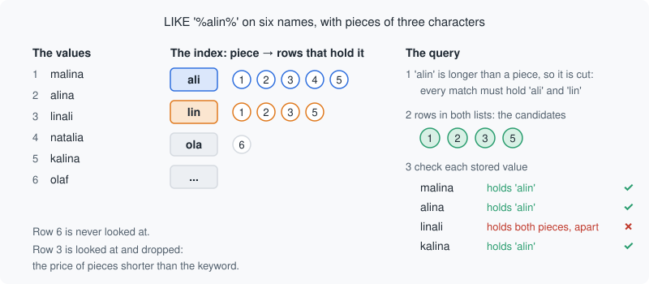

# Index the pieces of a value, then check the candidates

**Mark: settled.** [Back to the overview](README.md)

## The claim

A substring can be anywhere in a value, so an index of whole values does not help. The index
keeps every short piece of every value instead. A pattern is answered by finding the rows that
hold all of its pieces, and then checking those few rows against the stored value.

## An example

Six names, and pieces of three characters. `malina` gives `mal`, `ali`, `lin`, `ina`.

`LIKE '%alin%'` is longer than a piece, so it is cut into `ali` and `lin`:

1. Every name that holds `alin` holds both pieces. The index lists the rows for each piece, and
   the rows in both lists are the *candidates*: rows 1, 2, 3 and 5.
2. A candidate is not yet a match. `linali` holds both pieces, but apart. Each candidate's
   stored value is checked, and row 3 is dropped.

## The picture

**How to read it.** The middle column is the index: one list of rows per piece. The right
column is one query, top to bottom. Row 6 never appears on the right: the index ruled it out
without reading it.

**When no check is needed.** A keyword no longer than a piece is one exact lookup, and every row
in its list is a match. `LIKE '%ali%'` is answered from the `ali` list alone.

**The start and the end of a value are pieces too.** Each value is indexed with a mark before
its first character and after its last, so `LIKE 'ali%'` looks for the piece "mark, a, l", and a
prefix or a suffix pattern costs what any other does.

## The evidence

10 million names, one index node with 4 vCPUs (AWS runs `0818814c` and `9a843776`).

| Query | Throughput | Time inside the index per query |
|---|---|---|
| A keyword that matches nothing | 47,000 to 54,000 queries/s | about 0.06 ms |
| A two-character keyword, page of 20 | 16,900 queries/s | about 0.04 ms |
| An eight-character keyword, page of 20 | 11,300 queries/s | about 0.3 ms |

The eight-character keyword is slower because it is checked row by row. Checking one candidate
costs about half a microsecond when its value is cached.

## Three refinements

- **Only the rarest pieces are looked up.** A long keyword has many pieces, and the common ones
  add work without removing candidates. The index intersects the four rarest and lets the check
  drop what the others would have (`rarest_grams`, default 4).
- **A part of the index that lacks a piece is skipped whole.** The index is stored in parts
  (see [Keep each piece of the index narrow](04-narrow-pieces.md)), and one that has no row
  with some piece of the pattern is not opened.
- **A simple pattern is checked without a regular expression.** Building one cost about 0.055 ms
  per query, more than the search itself.

## Limits

- **False candidates have no bound.** If many rows hold the pieces apart and few hold them
  together, every one of them is read and dropped. A keyword built to do this (a thousand
  candidates per match) cost 11 ms for a page of 20 on 2 million rows. Longer pieces reduce it:
  pieces of four characters made the index a third larger (run `a7be7f76`). The
  [budget](07-a-budget.md) keeps such a query from holding the node.
- **A keyword shorter than the shortest piece cannot be answered** and is refused
  (`min_gram`, default 1, so by default nothing is refused).
- **The index is eventually consistent.** A row written a moment ago may not be found yet, and
  rows are not checked against the table again.

## Code

| What | Where |
|---|---|
| Cutting values and patterns into pieces | [gram.rs](../../vector-store/crates/vector-store/src/pattern_index/gram.rs), [like.rs](../../vector-store/crates/vector-store/src/pattern_index/like.rs) (upstream) |
| `min_gram`, `max_gram` | vector-store `c7d90fc`, scylladb `7fc6095159` |
| Skip a part that lacks a piece | vector-store `9f395f0` |
| The rarest pieces only | vector-store `18c194f`, scylladb `a0158bbece` |
| The check without a regular expression | vector-store `92ea6fd` |
