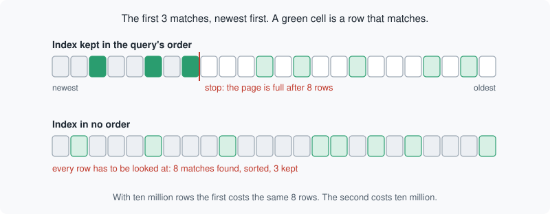

# Keep the index in the order the query asks for

**Mark: settled.** [Back to the overview](README.md)

## The claim

A search box shows the first 20 results, in some order. If the index is kept in that order, the
first 20 matches it meets are the answer, and it can stop. If it is not, every match has to be
found and sorted before the first one can be shown.

## An example

24 users, newest first, 8 of whom match. The query wants the 3 newest matches.

- **Index in the query's order:** read from the newest end. The third match is the eighth row.
  Stop there.
- **Index in no order:** all 24 rows are looked at, 8 matches are found and sorted, 3 are kept.

The first costs 8 rows whether the table has 24 rows or ten million. The second costs the table.

## The picture



**How to read it.** Each cell is a row in the order the index keeps it. Grey cells were looked
at. Dark green cells are on the page.

## What "the order" is

Every row gets a sort key when it is indexed, made of three parts compared left to right:

1. **The ordering columns**, if the index was created with any, up to four. A column declared
   `DESC` is stored inverted, so that "highest first" is still "lowest key first".
2. **The partition's place**, which keeps the rows of one partition together
   (see [Where the rows of a page are read](08-where-rows-are-read.md)).
3. **The primary key**, in the table's own clustering order, which breaks every remaining tie.

So the order is total: any two rows compare one way, always the same way.

```sql
CREATE CUSTOM INDEX ON ks.users (name) USING 'pattern_index'
    WITH OPTIONS = {'order_by': 'registered_at DESC'};

SELECT user_id, name FROM ks.users
    WHERE name LIKE '%ali%' ORDER BY registered_at DESC LIMIT 20;
```

- An index serves a query that orders by a prefix of its columns, all as declared or all
  reversed. The reverse is the same walk from the other end.
- A range on the first ordering column (`registered_at < '2026-01-01'`) narrows the walk.
- Several indexes with different orders can sit on one column. ScyllaDB picks the one whose
  order fits the query.
- An index with no `order_by` serves a `LIKE` with no `ORDER BY`.

## The evidence

On 10 million names, a page of 20 for a frequent two-character keyword read about **50 index
entries per query** (AWS run `9a843776`), in every order tested: no ordering column, a column
of five values, and a timestamp either way. The index held millions of entries for that keyword.

## Limits

- **An ordering column must be an integer, a date, a time or a timestamp.** Rows where it is
  null are not in the index, as a materialized view leaves out rows with a null key.
- **The order is fixed when the index is created.** A new order is a new index, and each index
  is a full copy in the index node's memory.
- **A query whose order no index has is refused**, not answered slowly.

## Code

| What | Where |
|---|---|
| The sort key | [order.rs](../../vector-store/crates/vector-store/src/pattern_index/order.rs) |
| No ordering column | vector-store `4da281d`, scylladb `863e3e1039` |
| `order_by` | vector-store `f997471`, scylladb `d0eaac2ae4` |
| Either direction | vector-store `235c9d1` |
| A range on the first column | vector-store `9cb9754`, scylladb `8bd3d7a15c` |
| Picking the index that fits | scylladb `d4cc85e796` |
