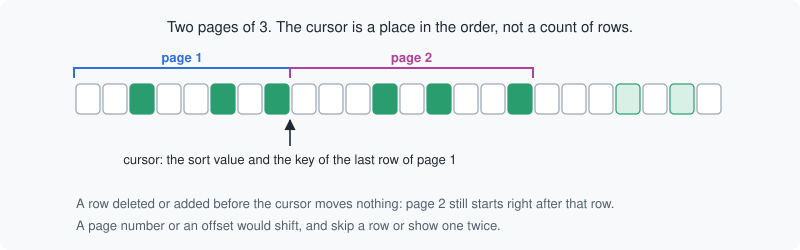

# A cursor names a place in the order

**Mark: settled.** [Back to the overview](README.md)

## The claim

The second page has to start exactly where the first one stopped. A page number cannot promise
that while rows are being written. A cursor that names the last row's place in the order can:
no row is skipped and none is shown twice.

## An example

Two pages of 3 over the same 24 users. Page 1 ends at the eighth row.

- **With an offset** ("skip 3 matches"): if a new matching user registers before page 2 is
  asked for, the third match of page 1 becomes the fourth, and page 2 shows it again.
- **With a cursor**: page 2 asks for "the rows after *this* row", by the row's sort key. The new
  user sorts before the cursor and does not move it.

## The picture

## How it travels

1. The index node answers a page with the keys and a cursor: the sort key and the primary key
   of the last row it returned.
2. ScyllaDB puts the cursor in the driver's *paging state*, the opaque token every paged CQL
   query already carries.
3. The client asks for the next page as it would for any query. It never sees the cursor.

Rows that tie on every ordering column are told apart by the primary key in the cursor, so a
page boundary in the middle of a tie is exact.

## The evidence

- **A unit test** follows every page of five keywords from its cursor, in both directions and
  within a range, on three differently built indexes, and compares the rows with a full read
  (`pages_hold_the_same_rows_whatever_the_runs`).
- **Through ScyllaDB**, a benchmark plan checks 44 sets of queries row by row against the
  expected pages, in four orders. Every one matched (docker run of 2026-11-24).

## Limits

- **A page is at most 1,000 rows.** A paged query needs no `LIMIT`; an unpaged one needs a
  `LIMIT` of at most 1,000.
- **A page can come back short, or empty, and still not be the last.** See
  [A budget of time](07-a-budget.md). "No more rows" is when no cursor comes back.
- **A paging state from before the index existed is refused.** It has no cursor in it.

## Code

| What | Where |
|---|---|
| The cursor on the index node | `Cursor` in [tantivy.rs](../../vector-store/crates/vector-store/src/pattern_index/tantivy.rs); vector-store `4da281d` |
| A page at a time over HTTP | scylladb `1660e74e79` |
| The cursor in the paging state | scylladb `b0abbccdad` |
