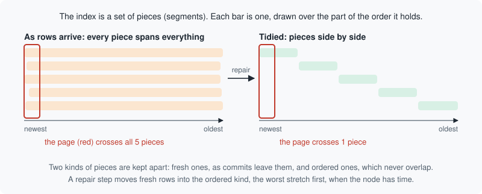

# Keep each piece of the index narrow in the order

**Mark: working.** It does its job, and we expect to simplify how. [Back to the overview](README.md)

## The claim

The index is not one sorted list. It is stored as a set of pieces (*segments*), because rows
keep arriving and a piece, once written, is never changed. A page is cheap only if it has to
open few pieces. That holds when each piece covers a narrow stretch of the order and the pieces
do not overlap, and it has to be made to hold, because rows do not arrive in order.

## An example

Ten million users indexed newest first, in pieces of at most 200,000 rows: about 70 pieces.

- **Side by side:** the 20 newest matches are all in the first piece. One piece is opened.
- **Each piece spanning everything**, as they are when rows arrive in no order: the 20 newest
  matches could be in any of them. All 70 are opened.

## The picture

**How to read it.** Each bar is a piece, drawn over the stretch of the order its rows cover. The
red frame is where a page of the newest rows looks.

## How the pieces are kept narrow

1. **A cap on size** (`segment_rows`, default 200,000). Pieces are merged only up to it, so a
   piece cannot grow to cover the whole order.
2. **Two kinds of pieces, never merged together.** *Fresh* pieces are what commits leave, in
   whatever order the rows came. *Ordered* pieces never overlap each other.
3. **A repair step** takes fresh rows from the stretch of the order that has the most of them
   and rewrites them into the ordered kind. It runs again and again until no fresh row is left.
4. **The repair waits its turn.** It does not run while an index is being built from a full
   scan, nor while changes from the table are arriving late, nor while writes are waiting for a
   thread. A burst of writes leaves more fresh pieces for a while, which searches pay for,
   instead of delaying the writes.

## The evidence

| | Measured |
|---|---|
| 10 million rows loaded through the change log into three indexes | all caught up 11 minutes after the load, and settled 5 minutes later at about 72 pieces each (AWS run `9a843776`) |
| A page of 20 on a settled index, 2 million rows | 0.02 to 0.07 ms |
| The same before the repair has run | 0.15 to 0.43 ms |
| Under 5,000 writes/s, the same queries | 12,300 against 16,900 queries/s with no writes (AWS run `9a843776`) |

## Why this part is marked "working"

- **The rules for when to repair are several and were each added after a measurement went
  wrong.** They work together, but they are hard to reason about.
- **A row that arrives out of order is indexed twice**: once when it arrives, once when it is
  repaired.
- **The write path under it will change** when rows are sent in batches (VECTOR-1186).

## Code

| What | Where |
|---|---|
| The cap, the two kinds, merging from the tick | vector-store `0576b52`, scylladb `2bfd34512e` |
| The repair (`rewrite`) | vector-store `8c545f4` |
| No repair during a full scan or while changes lag | vector-store `656a2c5` |
| The repair gives way to writes | vector-store `ca83274`, `166d8b0` |
| Design notes, with the measurements behind each rule | [stage-2-ordering.md](../../vector-store/docs/dev/pattern/stage-2-ordering.md), "Two tiers and a continuous repair" |
