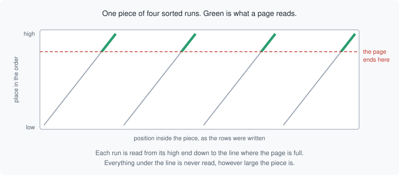

# Read a piece from the end the page needs

**Mark: settled.** [Back to the overview](README.md)

## The claim

Opening the right piece is not enough: a piece of 200,000 rows may hold 40,000 matches, and the
page wants 20. Inside a piece the rows lie in a few sorted stretches (*runs*). The index reads
each run from the end the page needs and stops when the page is full, so the work follows the
size of the page, not of the piece.

## An example

One piece written by four threads. Each thread wrote its share of the rows in order, so the
piece is four runs, each rising from the lowest place in the order to the highest.

A page of the 20 highest rows needs only the top of each run. The index:

1. Reads a short stretch from the high end of every run.
2. Draws a line under the lowest row it can already be sure of.
3. If the page is not full, reads a wider stretch, but only from the runs that still reach
   above the line.
4. Stops when the page is full. Everything under the line was never read.

## The picture

## Four refinements

Each was added because the measurement of a page over many shapes of data showed one shape
costing far more than the rest.

- **A stretch is sized by how common the keyword is,** so a rare keyword starts wide and a
  common one narrow.
- **Rows in no order are read in blocks.** A block that cannot reach the page, by its highest
  row, is skipped.
- **Runs with no match are found in one sweep** and left out, after a pass that met nothing.
- **A piece with very few matches is read whole,** in one go. It is cheaper than visiting each
  run for one row.

## The evidence

10 million rows, one index, 4 cores, time inside the index for a page of 20, over twelve
keywords and three kinds of page (the page-cost matrix in the vector-store tests):

| | Before | Now |
|---|---|---|
| Index entries read for a keyword in every row | 720 to 3,160 | 43 |
| Median page, pieces of 1 million rows | 0.12 ms | 0.019 ms |
| Slowest ordinary page, pieces of 1 million rows | 1.0 ms | 0.28 ms |
| A page of 1,000 | 0.85 to 2.5 ms | 0.4 to 0.55 ms |

On the cluster, the same change took a frequent keyword from 7,300 entries read per query (AWS
run `7a300b9d`) to about 50 (run `9a843776`).

A larger piece no longer costs a page anything, which it did before.

## Limits

- **A rare keyword in a piece of many runs** costs a visit to each run: 0.37 ms where reading
  the piece whole took 0.07 ms. The threshold between the two ways is not tuned.
- **The index reads one piece at a time.** Where pieces overlap, a piece is finished before the
  next is opened, even if the next holds better rows.
- **False candidates** are not helped by any of this: each one is a stored value read.

## Code

| What | Where |
|---|---|
| The runs of a piece, read as a merge by key | `walk_runs` in [tantivy.rs](../../vector-store/crates/vector-store/src/pattern_index/tantivy.rs); vector-store `511c4dd` |
| How much a pass takes from each run | vector-store `38969ff`, `9668c65` |
| The sweep after a pass with no match | vector-store `6ee1d57` |
| Reading a piece whole | vector-store `17dea3e` |
| The page-cost matrix | vector-store `1227988` |
