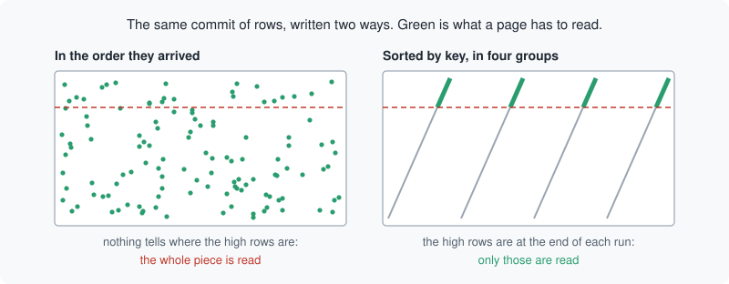

# Write each commit in the order of its keys

**Mark: settled.** [Back to the overview](README.md)

## The claim

Reading a piece from the end the page needs only works if the piece has sorted runs. Rows that
arrive in no order made pieces with none, and such a piece has to be read whole. Sorting the
rows of each commit before writing them gives every new piece sorted runs, at almost no cost,
so fresh rows are as cheap to read as old ones.

## An example

A commit of 10,000 rows that arrived in no order, on a node whose writer has four threads.

- **Written as they came:** the highest rows are anywhere in the piece. Nothing says where, so a
  page reads all of it.
- **Sorted first, then dealt to four groups:** each group is written in order and becomes one
  run. The highest rows are at the end of each run, and a page reads only those.

## The picture

## How it is done

1. Rows are **held** in memory until the commit, each with its sort key. A commit happens every
   second, or at 10,000 rows.
2. At the commit they are **sorted by key and dealt round-robin into groups**, as many as the
   writer has threads and none under 1,024 rows.
3. Each group is **written in one go**, in order, and becomes one sorted run.

A row removed before the commit is taken out of the held rows.

## The evidence

2 million rows arriving in random order, repair switched off, the same data written both ways:

| | As they came | In key order |
|---|---|---|
| Keyword in every row, page of 20 | 0.69 ms, 27,400 entries read | 0.30 ms, 1,220 entries |
| Keyword in every row, page of 1,000 | 13.4 ms | 1.5 ms |
| Longest single request with a 50 ms budget | 2,314 ms | 69 ms |
| Median over the whole matrix | 1 | 0.59 |

On the cluster, with 5,000 writes/s running beside the queries, entries read per query fell from
6,100 to 150, and those phases gained 16 to 18% in throughput (AWS run `0818814c` against
`a2b5883f`).

## Limits

- **A keyword with a few matches per thousand rows got slower**, 0.07 to 0.37 ms, because the
  piece is now visited run by run where it used to be read whole. Same limit as in
  [Read a piece from the end](05-reading-a-piece.md).
- **Rows are held in memory until the commit**, one second's worth at most.
- **This will move** when rows are sent to the index in batches (VECTOR-1186): a batch is the
  natural thing to sort.

## Code

| What | Where |
|---|---|
| Holding, sorting and writing a commit's rows | `write_held` in [tantivy/mod.rs](../../vector-store/crates/vector-store/src/tantivy/mod.rs); vector-store `f334c9b` |
| The first stretch divided among overlapping runs | vector-store `9668c65` |
