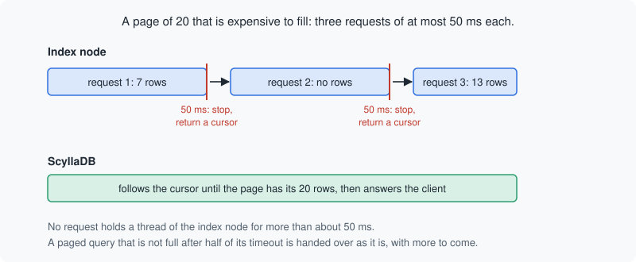

# Give a request a budget of time

**Mark: settled.** [Back to the overview](README.md)

## The claim

Most pages take well under a millisecond, but some patterns have no bound: a keyword with many
false candidates, or a rare one on a large index. Such a query used to hold a thread of the
index node until it was done, even after ScyllaDB had given up on it. Now a request has a
budget of time. When it runs out, the index returns the rows it is sure of and a cursor, and
the query goes on in the next request.

## An example

A page of 20 for a keyword where a thousand rows have to be read and dropped for each match.

1. **Request 1** runs for 50 ms, has 7 rows it is sure of, and returns them with a cursor.
2. **Request 2** starts at the cursor, runs for 50 ms, and finds nothing it is sure of. It
   returns no rows and a cursor further on.
3. **Request 3** finds the remaining 13 rows before its time is up.

ScyllaDB makes the three requests and hands the client one page of 20.

## The picture

## What makes a cut page still correct

When the time runs out, the index knows the highest place in the order it has *not* examined.
Every row it holds above that place is final: nothing unread can sort before it. Those rows are
returned, and the cursor is that place. The next request reads on from there, so no row is lost
and the order is kept.

## What ScyllaDB does with a short page

- **A paged query** keeps asking for half of the statement's timeout. If the page is still not
  full, the client gets what there is, with a paging state, and asks again as for any page.
- **An unpaged query** keeps asking until its `LIMIT` is met. If the timeout comes first it
  fails, as it did before: its client cannot ask for the rest, so a short answer would pass for
  a whole one.

## The evidence

2 million rows, the keyword with a thousand candidates per match, budget of 50 ms:

| Index | Page | Requests | Longest request | Total | One request, no budget |
|---|---|---|---|---|---|
| settled | 200 rows | 3 | 56 ms | 120 ms | 112 ms |
| settled | 1,000 asked, 666 exist | 8 | 55 ms | 408 ms | 365 ms |

So the whole page costs about a tenth more, and no single request holds a thread for longer
than the budget plus a few milliseconds. Every ordinary query in the matrix was within 5 to 8%
of the run without a budget, which is what two runs of the same build differ by.

Four tests against a mock index node cover the ScyllaDB side: a short page is topped up, an
empty page is handed over after half the timeout, an unpaged query is topped up to its `LIMIT`,
and an unpaged query fails at the timeout.

## Limits

- **The budget is one setting for the whole node** (`VECTOR_STORE_PATTERN_SEARCH_BUDGET`,
  default `50ms`, `0s` for none), not per index and not per request. A change takes effect
  on a configuration reload, without a restart.
- **A large piece with no sorted runs is read whole before anything is sure**, so a request
  over one can run long past the budget. [Sorted commits](06-sorted-commits.md) removed almost
  all such pieces.
- **Queries that match nothing paid for the clock**, 15 to 30% of their time in the index, until
  the budget was made to look at it only for a part of the index that has candidates
  (vector-store `7579a9c`).

## Code

| What | Where |
|---|---|
| The budget and the cut | `SearchBudget`, `Spending` in [tantivy.rs](../../vector-store/crates/vector-store/src/pattern_index/tantivy.rs); vector-store `7579a9c` |
| The setting | vector-store `b68c8c9` |
| Topping up a short page | [ordered_pattern_select_statement.cc](../../scylladb/cql3/statements/external_search/ordered_pattern_select_statement.cc); scylladb `0c9559b487` |
