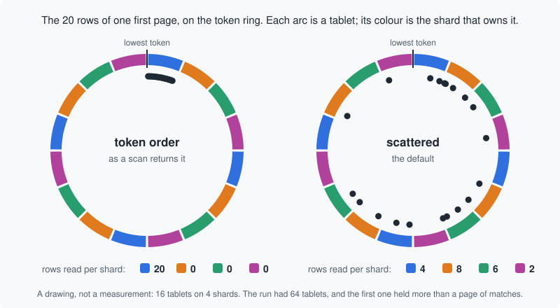

# Where the rows of a page are read

**Mark: settled.** [Back to the overview](README.md)

## The claim

The index decides which 20 rows a page holds. ScyllaDB then has to read those 20 rows. If the
index orders partitions the way a table scan does, every first page of every frequent keyword
is read from the same small part of the cluster. Ordering partitions in a fixed scrambled order
spreads those reads over the whole cluster, and nearly doubled the throughput.

## An example

A table of users, partitioned by `user_id`. ScyllaDB places a partition by its *token*, a hash
of the key, and a scan returns partitions from the lowest token to the highest. The token range
is cut into *tablets*, and each tablet belongs to one CPU core (a *shard*) of one node.

Take `WHERE name LIKE '%an%' LIMIT 20` on ten million names, and say one name in five matches.

- **In token order**, the 20 rows are the 20 matches with the lowest tokens. With a match every
  five rows, they are all among the first hundred rows of the ring: one tablet, one shard.
- The next user searches `'%er%'`. Different rows, but again the matches with the lowest
  tokens: the same tablet, the same shard.

So the keyword changes and the place does not. One shard reads the rows of every first page.

## The picture



**How to read it.** The ring is the token range; a scan starts at the top and goes clockwise.
Each dot is one row of the page. On the left the dots sit on top of each other at the start of
the ring. On the right the same number of rows land wherever their scrambled position falls.

**Why scattering needs no knowledge of the cluster.** The scramble is one fixed function of the
token. Twenty places chosen that way are spread over the ring however the ring is cut, so the
index does not need to know where the tablets are, and nothing changes when tablets split, merge
or move.

**What stays the same.** The rows of one partition still come together and in their clustering
order, and the order is the same for every request, so paging is exact. Only the order *between*
partitions is given up, and since that order is a hash it meant nothing to a user anyway.

## The evidence

Two AWS runs of the same plan, one day apart, on one ScyllaDB node with 4 shards and one index
node. The only difference is the order of partitions.

| Frequent keyword, page of 20 | Token order (run `0818814c`) | Scattered (run `9a843776`) |
|---|---|---|
| 64 clients | 9,400 queries/s | 16,900 queries/s |
| 16 clients | 9,800 | 14,500 |
| 256 clients | 8,600 | 18,000 |
| with 5,000 writes/s | 7,100 | 12,300 |
| ScyllaDB busy: all shards on average | 49% | 90% |
| ScyllaDB busy: the busiest shard | 100% | 98% |

- In token order, throughput did not move from 16 to 256 clients: one shard was full while the
  node as a whole was half idle.
- A CPU profile of that run shows every row read on shard 0, and the tablet map shows the
  ring's first tablet on shard 0.
- The cost per query on the index node is the same in both runs. The whole gain is in where
  ScyllaDB reads.
- The gain is far above the run-to-run noise of about 20%.

**How far to trust the size of the gain.** The benchmark repeats a handful of keywords, which is
the worst case for token order. Real traffic would see the same effect on first pages of
frequent keywords and less on rare ones.

## Limits

- **An index built over a table that is already loaded** receives its rows in token order. In
  token order that is exactly the index's own order, for free. Scattered, the rows arrive in no
  order and the index has to be tidied afterwards. On 2 million rows locally this made the build
  10% longer; it has not been measured at 10 million.
- **The rows of a page are no longer neighbours**, so they cannot be read with one cheap range
  read. Reading them is now the slowest step for frequent keywords.
- **The order differs from the same query without the index.** An index that must return the
  order of a scan can ask for it.

## How to choose

The order of partitions is an index option:

```sql
CREATE CUSTOM INDEX ON ks.users (name) USING 'pattern_index'
    WITH OPTIONS = {'partition_order': 'token'};      -- the order of a scan
```

Without the option the index is `scattered`. The option also decides the order among rows that
tie on an `order_by` column, which is how an index ordered by a column with few values got the
same hot shard and the same fix.

## Code

| What | Where |
|---|---|
| The scramble, one function | `scattered_key` in [order.rs](../../vector-store/crates/vector-store/src/pattern_index/order.rs) |
| The option | `PartitionOrder` in [lib.rs](../../vector-store/crates/vector-store/src/lib.rs); vector-store commit `2922a8d` |
| Validation of the option | [pattern_index.cc](../../scylladb/index/pattern_index.cc); scylladb commit `c869e07ceb` |
| The benchmark plan | [aws_partition_config.yaml](../../scylla-cluster-tests/data_dir/latte/substring_search/aws_partition_config.yaml) |
