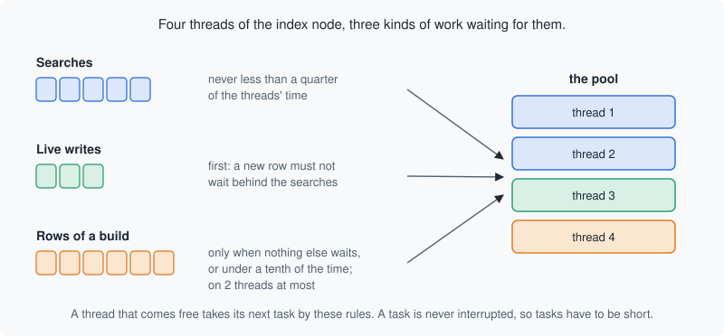

# Three classes of work on the index node

**Mark: working.** The measured gain is modest, and the question is open upstream too.
[Back to the overview](README.md)

## The claim

The index node has a few threads, and three kinds of work want them: searches, writes that keep
an index up to date, and the writes that build a new index. Served first come first served,
they hurt each other. Each kind now waits in its own queue, and a thread that comes free picks
by a few rules, so that new rows become searchable quickly and building one index does not
stall the searches of another.

## An example

A node with four threads serves searches on index A while index B is being built from the table.

- **Before:** B's rows were served ahead of A's searches, for as long as the build took.
- **Now:** B's rows wait for A's searches. They run when no search is waiting, and otherwise
  get a tenth of the threads' time, so that the build still finishes on a busy node.

## The picture

## The rules

| Kind of work | Rule |
|---|---|
| **Live writes** (a row added or removed, a commit) | First. A row a client just wrote should not wait behind searches. |
| **Searches** | Never less than a quarter of the threads' recent time while any are waiting, whatever the writes do. |
| **Rows of a build** | Only when nothing else waits, or while they have had less than a tenth of the recent time. On at most half of the threads at once. |

The three numbers are settings, and they take effect without a restart.

## Three things the first version got wrong

- **A row's changes must stay in one queue.** A build row that replaces an older value is a
  removal followed by an add. In different queues they could run in the wrong order.
- **Waiting must not block the others.** All kinds reach the pool through one channel, so a
  build row waiting in it for room would have held up the searches behind it. The pool now
  takes it at once and tells the sender when there is room.
- **Build rows must not take every thread.** They all need the same lock on their index, and a
  commit holds it for about 30 ms. In a quiet moment every thread took one and waited behind
  the commit, leaving none for the next search. Hence the cap at half.

## A stall that was not about scheduling

After the cap, one search in a hundred still took 20 ms. A trace showed a task that ran for
almost exactly 100 ms after nearly every commit: the reader being reloaded. The reload and the
storage library's clean-up of unused files need the same lock, the reload arrives just as the
clean-up starts, and the library waits for that lock by sleeping 100 ms. One thread of four was
asleep most of the time. The reload now checks the lock itself every 0.1 ms and goes on as soon
as it is free.

This is not special to the pattern index. A full-text index of 1 million documents built on
upstream's code slept this way after one commit in four, a thread asleep for a quarter of the
build.

## The evidence

A settled index of 1 million rows searched by 8 clients with 5 ms between their queries, and a
second index of 1 million rows being built, on 4 threads:

| Build rows served as | Searches, against no build | Wait for a thread | 99th percentile |
|---|---|---|---|
| live writes (before) | 25% fewer | not measured | 27 ms |
| build rows, no cap | 20% fewer | 1.5 ms | 25 to 27 ms |
| build rows, capped | 8% fewer | 0.5 ms | 18 to 21 ms |
| and the reload fix | 6 to 7% fewer | 0.18 ms | 5.3 ms |

Without a build the 99th percentile is 1.6 ms. Rows 2 to 4 are two runs each. This is a local
benchmark on a laptop, not a cluster run.

## Why this part is marked "working"

- **A search runs longer beside a build, by as much as the machine shares:** 33% longer where
  a search and a build thread ran on two hyperthreads of one core, 8% where each had a core of
  its own, which is what heavy memory traffic alone costs. The 8% is what to expect on a node
  whose vCPUs are whole cores.
- **On a saturated node the build pays:** it took 50 s where it took 34 s, for 11% more search
  throughput.
- **The vector index is not covered:** its writes still count as searches.
- **Upstream is discussing the same question** for the vector index, with a different answer
  ([vector-store #684](https://github.com/scylladb/vector-store/pull/684)).

## Code

| What | Where |
|---|---|
| Live writes ahead of searches, with a floor for searches | [worker.rs](../../vector-store/crates/vector-store/src/worker.rs); vector-store `12f2e0e` |
| The class for build rows, and its cap | vector-store `aa9f25d` |
| Settings that follow a configuration reload | vector-store `b10f2a9` |
| The reload that slept 100 ms | `wait_for_the_meta_lock` in [tantivy/mod.rs](../../vector-store/crates/vector-store/src/tantivy/mod.rs); vector-store `b9ad58f` |
| The benchmark | vector-store `d95dada` |
