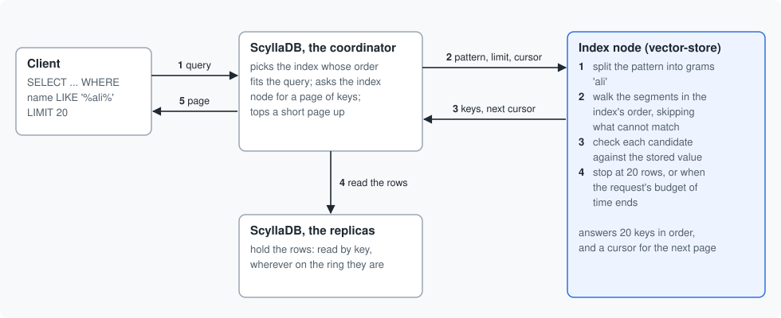

# Substring search with a pattern index: how it works

`WHERE name LIKE '%ali%'` normally reads every row of the table. This proof of concept answers
it from an index on a separate node, in a chosen order, one page at a time. The work for a page
follows the size of the page, not the size of the table.

These pages explain the ideas behind it, one idea per page. They are meant to be read by a
person who has not seen the code.

## How to read these pages

Every page has the same five parts:

1. **The claim**, in one or two sentences.
2. **An example** small enough to follow by hand.
3. **A picture** of the mechanism.
4. **The evidence**: what was measured, on which run, and how far to trust it.
5. **Limits and code**: what the idea does not cover, and where it lives.

Each idea carries one of three marks:

| Mark | Meaning |
|---|---|
| **settled** | Measured on a cluster, and we do not expect the design to change. |
| **working** | Implemented and measured, but we expect to change how it is done. |
| **open** | A known gap, or a result we cannot explain yet. |

## The ideas

| # | Idea | What it buys | Mark | Page |
|---|---|---|---|---|
| 1 | Index every short piece of a value, then check the candidates | A substring is found without reading the table | settled | [Index the pieces of a value](01-pieces-of-a-value.md) |
| 2 | Keep the index in the order the query asks for | A page is the first rows met, not a sort of all matches | settled | [The index in the query's order](02-the-index-in-query-order.md) |
| 3 | A cursor names a place in that order | The next page starts where the last one stopped, with no row skipped or repeated | settled | [A cursor](03-a-cursor.md) |
| 4 | Keep each piece of the index narrow in that order | A page touches a few pieces, not all of them | working | [Narrow pieces](04-narrow-pieces.md) |
| 5 | Read a piece from the end the page needs, and skip what cannot match | The work follows the size of the page, not of the index | settled | [Reading a piece](05-reading-a-piece.md) |
| 6 | Write each commit in the order of its keys | Fresh rows are as cheap to read as old ones | settled | [Sorted commits](06-sorted-commits.md) |
| 7 | Give a request a budget of time | No single query can hold the index node | settled | [A budget of time](07-a-budget.md) |
| 8 | Scatter the partitions | The rows of a page are read from every shard, not from one | settled | [Where the rows of a page are read](08-where-rows-are-read.md) |
| 9 | Three classes of work on the index node | Building one index does not stall the searches of another | working | [Three classes of work](09-three-classes.md) |

## Results at a glance

One ScyllaDB node and one index node, 4 vCPUs each, 10 million names, a page of 20, 64 clients
(AWS runs `0818814c` and `9a843776`, 2026-11-23 and 24). Differences under about 20% between
runs are noise.

| Query | Throughput | What limits it |
|---|---|---|
| A frequent two-character keyword, any order | 16,800 to 17,500 queries/s | ScyllaDB reading the 20 rows |
| The same with 5,000 writes/s to the table | 12,300 to 13,600 queries/s | ScyllaDB, reads and writes together |
| An eight-character keyword | 11,300 to 11,500 queries/s | the index node |
| A keyword that matches nothing | 47,000 to 54,000 queries/s | the index node |

## What is not solid yet

- **How the index is kept in shape as rows arrive** (idea 4). It works, but it is the most
  intricate part, with several rules about when to tidy up and when to wait. We expect to
  simplify it.
- **How the index node shares its threads** (idea 9). The measured gain is modest, and the
  same question is being discussed for the vector index.
- **The index lives in memory.** About 0.3 GB per million names. Nothing here addresses an
  index larger than the node's memory.
- **Reading the rows is now the slowest step** for frequent keywords, and nothing in this work
  makes it cheaper yet.

## Where the code is

| Repository | Branch | What is there |
|---|---|---|
| [vector-store](../../vector-store) | `pattern-index-poc-upstream` | the index: `crates/vector-store/src/pattern_index/` |
| [scylladb](../../scylladb) | `pattern-index-poc-upstream-split` | the query path: `cql3/statements/external_search/` |
| [scylla-cluster-tests](../../scylla-cluster-tests) | `pattern-index-poc-upstream` | the benchmark: `substring_test.py` |

The engineering notes, with every measurement and dead end, are in
[vector-store/docs/dev/pattern](../../vector-store/docs/dev/pattern). These pages are the short
version.
